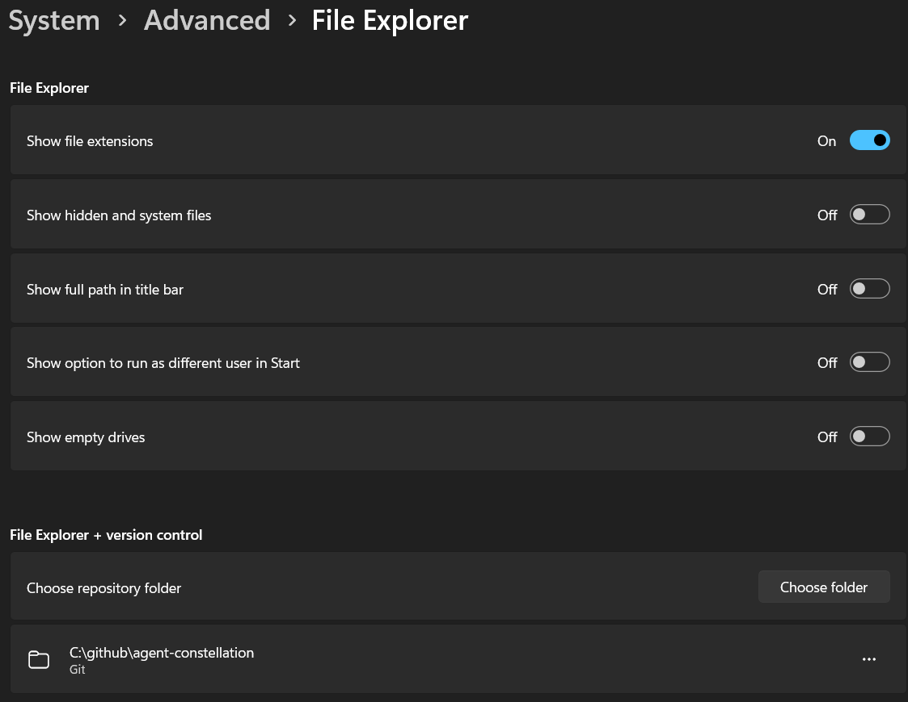

# Explorer Git Repos

Bulk-add your local Git repositories to Windows 11's **File Explorer + version control** settings with PowerShell.

Windows can show Git information such as the current branch, last commit author, and last commit message directly in File Explorer. First, though, you have to tell Windows which folders are repositories. The Settings UI lets you choose them one at a time. If you keep dozens of repositories under a folder like `C:\github`, that gets tedious.

This script finds the repositories directly inside a parent folder and registers the missing ones in one run. It doesn't clone repositories, change Git configuration, or modify your source files.



*The Settings page with one repository added manually, before bulk registration.*

## Requirements

- Windows 11 with **Settings > System > Advanced > File Explorer > File Explorer + version control** available. Not every Windows build exposes this feature.
- Windows PowerShell 5.1 or PowerShell 7 on Windows.
- A writable copy of this script: backups and registration manifests are saved beside it.

Run as your normal Windows user. Administrator privileges are not required because these settings live under `HKEY_CURRENT_USER`. Registering folders does not install or enable the Windows feature on unsupported builds.

## Usage

Download or clone this repository, open PowerShell in its folder, and preview what would be added:

```powershell
.\Add-ExplorerRepositories.ps1 -Root 'C:\github' -WhatIf
```

Then register the repositories:

```powershell
.\Add-ExplorerRepositories.ps1 -Root 'C:\github'
```

`C:\github` is the default, so this works too:

```powershell
.\Add-ExplorerRepositories.ps1
```

Use a different parent folder if that's where you keep your checkouts:

```powershell
.\Add-ExplorerRepositories.ps1 -Root 'D:\src'
```

Review downloaded scripts before running them and follow your organization's PowerShell execution policy.

Close and reopen the Settings page to refresh the list. If Git details don't appear in File Explorer immediately, close and reopen File Explorer.

## What the script does

1. Looks at the immediate child directories of `-Root` for a `.git` directory or file.
2. Reads existing repository registrations and skips paths that are already registered.
3. Exports the existing registry branch to a timestamped `.reg` backup, if the branch exists.
4. Saves a timestamped `.clixml` manifest identifying the new registry keys before writing them.
5. Creates a GUID-named key for each missing repository and verifies its four string values.

It is safe to rerun without creating duplicate registrations for the same path. `-WhatIf` makes no changes and writes no backup or manifest.

The script deliberately does **not** recursively search inside repositories, generated folders, submodules, or worktrees. It registers only immediate child folders with a `.git` marker; it does not register `-Root` itself. Finding a `.git` file is not a guarantee that Windows supports that particular worktree or submodule layout.

## Where Windows stores the list

On the Windows installation where this was investigated, the manually added repository was stored here, not in a separate database:

```text
HKEY_CURRENT_USER\Software\Microsoft\Windows\CurrentVersion\Explorer\PerFolderRoots
```

Each repository has a GUID-named subkey containing these `REG_SZ` values:

| Value | Contents |
|---|---|
| `Path` | Absolute repository path, such as `C:\github\agent-constellation` |
| `FolderType` | `{69F1E26B-EC64-4280-BC83-F1EB887EC35A}` |
| `PropertyProvider` | `{1212F95B-257E-414E-B44F-F26634BD2627}` |
| `RegisteredAppID` | `windows.immersivecontrolpanel_cw5n1h2txyewy!microsoft.windows.immersivecontrolpanel` |

These values were copied from the entry created through Settings. Microsoft's [Windows Advanced Settings source](https://github.com/microsoft/windowsAdvancedSettings/blob/main/src/FileExplorerSourceControlIntegration/SourceControlProvider.cs) also identifies the release source-control provider with the `PropertyProvider` GUID above.

**This is an unofficial registry-based convenience script, not a documented Windows registration API.** Windows updates can change this implementation. Before using it on another build, add one repository through Settings and compare its registry entry with the values above. The script does not detect build compatibility automatically.

## Backups and undo

Files are saved next to the script:

```text
PerFolderRoots-before-<timestamp>.reg
PerFolderRoots-added-<timestamp>.clixml
```

They contain local paths, so they are excluded from Git by this repository's `.gitignore`. Keep them if you want to undo a run.

The simplest undo is to remove individual entries using their **... > Remove** menu in Settings. This unregisters them from Explorer integration; it does not delete the repositories.

To remove only the registrations listed in a particular run's manifest, inspect it first and preview the removal. Replace the example filename with the exact manifest you want:

```powershell
$added = Import-Clixml -LiteralPath '.\PerFolderRoots-added-<timestamp>.clixml'
$added | Format-Table Path, Key -AutoSize

$expectedParent = 'HKCU:\Software\Microsoft\Windows\CurrentVersion\Explorer\PerFolderRoots'
foreach ($entry in $added) {
    if ((Split-Path -Path $entry.Key -Parent) -ne $expectedParent -or
        (Split-Path -Path $entry.Key -Leaf) -notmatch '^\{[0-9A-Fa-f-]{36}\}$') {
        throw "Unexpected registry key in manifest: $($entry.Key)"
    }
    if (Test-Path -LiteralPath $entry.Key) {
        $current = Get-ItemProperty -LiteralPath $entry.Key -ErrorAction Stop
        if ($current.Path -ne $entry.Path) {
            throw "Registration changed since this manifest was saved: $($entry.Key)"
        }
        Remove-Item -LiteralPath $entry.Key -Recurse -WhatIf
    }
}
```

After reviewing the preview, remove `-WhatIf` from the `Remove-Item` command and rerun the loop to apply it. Only use manifests you trust.

Importing the `.reg` backup alone does **not** undo additions: registry imports merge values rather than deleting keys that weren't in the backup. The manifest identifies the newly added keys.

Failures stop the script but do not automatically roll back entries already written. Use the manifest to inspect or remove those additions.

## Further reading

- [Microsoft Learn: File Explorer Version Control Integration](https://learn.microsoft.com/en-us/windows/advanced-settings/fe-version-control)
- [Microsoft's Windows Advanced Settings project](https://github.com/microsoft/windowsAdvancedSettings)
- [ElevenForum: Add or remove repository folders](https://www.elevenforum.com/t/add-or-remove-repository-folders-for-file-explorer-version-control-in-windows-11.38851/)

Windows documents limitations for nested repositories, submodules, network shares, symlinks, WSL-mounted paths, and very large repositories. Registering a folder does not bypass those limitations.
